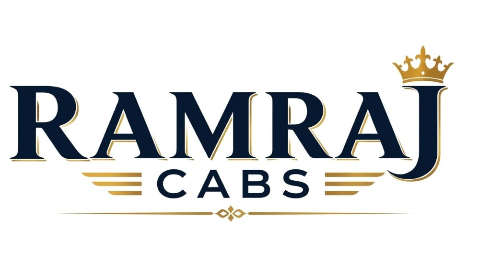

# Ramraj Cabs — Premium Uttarakhand & Delhi NCR Travel Services

<p align="center">
  
</p>

<p align="center">
  <strong>॥ हर सफर, विश्वास के साथ ॥</strong><br>
  <em>Har Safar, Vishwas Ke Saath — Trusted Private Taxi & Himalayan Pilgrimage Tour Partner</em>
</p>

<p align="center">
  <a href="https://github.com/mauryasapna/ramraj"></a>
  <a href="https://github.com/mauryasapna/ramraj"></a>
  <a href="https://github.com/mauryasapna/ramraj"></a>
  <a href="https://github.com/mauryasapna/ramraj"></a>
  <a href="https://wa.me/919128961411"></a>
</p>

---

## 🚩 Overview

**Ramraj** (Ramraj Cabs) is a modern, high-performance web application designed for private cab bookings, intercity expressway travel, and sacred Himalayan pilgrimage tours across **Uttarakhand and Delhi NCR**.

Built with **Next.js 16**, **React 19**, and **TypeScript**, the platform delivers an ultra-fast, mobile-optimized experience featuring instant WhatsApp booking generation, transparent all-inclusive pricing, vehicle capacity guides, and detailed day-wise tour itineraries.

---

## ✨ Key Highlights & Offerings

### 🛕 Sacred Pilgrimage & Dham Yatras
- **Char Dham Yatra (9N / 10D)** — Complete pilgrimage covering Yamunotri, Gangotri, Kedarnath & Badrinath.
- **Do Dham Yatra (5N / 6D)** — Sacred journey covering Baba Kedarnath and Badri Vishal.
- **Kedarnath Dham Yatra (4 Days / 3 Nights)** — Sonprayag base standby, helipad transfers, and temple darshan.
- **Tungnath & Chopta Yatra (3 Days)** — Sacred pilgrimage to the world's highest Shiva shrine (3,680m) & Chandrashila.
- **Yamunotri & Gangotri Special Tours** — Dedicated mountain vehicles with native Pahadi chauffeurs.

### 🏔️ Hill Stations & Sightseeing Packages
- **Mussoorie Sightseeing (Full Day)** — Kempty Falls, Company Garden, Mall Road, Gun Hill & George Everest.
- **Haridwar Sightseeing (Full Day)** — Har Ki Pauri, Mansa Devi, Chandi Devi, and world-famous Evening Ganga Aarti.
- **Rishikesh Sightseeing (Full Day)** — Ram Jhula, Triveni Ghat, Beatles Ashram & Parmarth Niketan.
- **Auli Snow & Ski Tour (3 Days)** — Asia's highest cable car ropeway, snow slopes & panoramic Nanda Devi views.
- **Chakrata Hill Tour (2 Days)** — Pristine deodar forests, Tiger Falls & Chilmiri Neck sunset.

### 🚗 Intercity Expressway & Airport Transfers
- **Delhi NCR ⇄ Dehradun Expressway (One Way)** — High-speed 4.5 hr transit via the new green expressway.
- **Delhi NCR ⇄ Haridwar Highway (One Way)** — Doorstep pickup and drop at Har Ki Pauri / railway station.
- **Delhi NCR ⇄ Mussoorie Queen of Hills (One Way)** — Direct mountain drive with hill-certified drivers.
- **Dehradun ⇄ Jolly Grant Airport Transfer** — Guaranteed on-time airport pickup/drop with flight delay tracking.

---

## 🚘 Fleet & Vehicle Categories

| Vehicle Type | Models | Seating Capacity | Ideal For |
| :--- | :--- | :--- | :--- |
| **Prime Sedan** | Swift Dzire, Toyota Etios | 4 Passengers + 1 Chauffeur | Solo, Couples & Small Families |
| **Family SUV** | Maruti Ertiga, XL6 | 7 Passengers + 1 Chauffeur | Families & Moderate Luggage |
| **Premium Hill SUV** | Toyota Innova Crysta | 7 Passengers + 1 Chauffeur | VIP & Luxury Hill Travel |
| **Group Travel** | Force Tempo Traveller | 12 to 26 Seater | Large Pilgrimage Groups & Corporates |

> **All-Inclusive Transparency**: All fares include full fuel, expressway & hill toll taxes, state border entry permits, and driver allowances. Zero hidden charges.

---

## 🛠️ Technology Stack

- **Framework**: [Next.js 16](https://nextjs.org/) (Turbopack, App Router)
- **UI Library**: [React 19](https://react.dev/)
- **Language**: [TypeScript](https://www.typescriptlang.org/)
- **Styling**: [Tailwind CSS](https://tailwindcss.com/)
- **Icons**: [Lucide React](https://lucide.dev/)
- **Storage / CMS**: Local JSON fallback + optional [Supabase](https://supabase.com/) & [ImageKit](https://imagekit.io/)
- **SEO & Performance**: OpenGraph, Schema.org Microdata, Turbopack bundle optimizations

---

## 🚀 Getting Started

### Prerequisites
- Node.js (v18.17 or later)
- npm, yarn, or pnpm

### Installation

1. Clone the repository:
   ```bash
   git clone https://github.com/mauryasapna/ramraj.git
   cd ramraj
   ```

2. Install dependencies:
   ```bash
   npm install
   ```

3. Configure Environment Variables (Optional):
   Create a `.env.local` file in the project root if integrating Supabase or ImageKit:
   ```env
   NEXT_PUBLIC_SUPABASE_URL=your_supabase_url
   NEXT_PUBLIC_SUPABASE_ANON_KEY=your_supabase_anon_key
   NEXT_PUBLIC_IMAGEKIT_URL_ENDPOINT=your_imagekit_endpoint
   ```

4. Start the local development server:
   ```bash
   npm run dev
   ```

5. Open your browser and navigate to:
   ```
   http://localhost:3000
   ```

### Production Build
```bash
npm run build
npm run start
```

---

## 📁 Project Structure

```text
cabs/
├── public/
│   └── images/               # High-resolution destination & package poster banners
├── src/
│   ├── app/
│   │   ├── api/              # API routes (content syncing & uploads)
│   │   ├── book/             # Direct cab booking interface
│   │   ├── gallery/          # Uttarakhand tourist destinations photo gallery
│   │   ├── packages/         # Comprehensive package details & breakdown
│   │   ├── reviews/          # Verified customer ratings & testimonials
│   │   ├── tours/            # Dedicated tour route highlights
│   │   ├── layout.tsx        # Root HTML layout with SEO metadata
│   │   └── page.tsx          # High-converting landing page
│   ├── components/
│   │   ├── BookingWidget.tsx # Interactive cab selector with live fare engine
│   │   ├── FeaturedThreeServicesSection.tsx # Modal with mobile-compact itineraries
│   │   ├── Navbar.tsx        # Responsive header with direct call CTA
│   │   ├── HeroSection.tsx   # Premium hero with trust badges
│   │   ├── ReviewsAndFAQSection.tsx # Accordion FAQs and user feedback
│   │   └── Footer.tsx        # SEO rich footer with regional route links
│   ├── data/
│   │   ├── cabData.ts        # Primary TypeScript data source (fares, fleets, itineraries)
│   │   └── siteContent.json  # Synchronized JSON store for dynamic edits
│   └── lib/                  # Database & asset helper modules
└── package.json
```

---

## 📞 Contact & Bookings

- **Brand**: **RAMRAJ CABS** (Ramraj Tour & Travels)
- **Direct Phone**: [+91 91289 61411](tel:+919128961411)
- **WhatsApp**: [+91 91289 61411](https://wa.me/919128961411)
- **Email**: [travellervikashraj@gmail.com](mailto:travellervikashraj@gmail.com)
- **Offices**: Haridwar & Dehradun, Uttarakhand

---

<p align="center">
  <sub>Developed with ❤️ for pilgrims and travelers exploring the sacred Himalayas.</sub>
</p>
